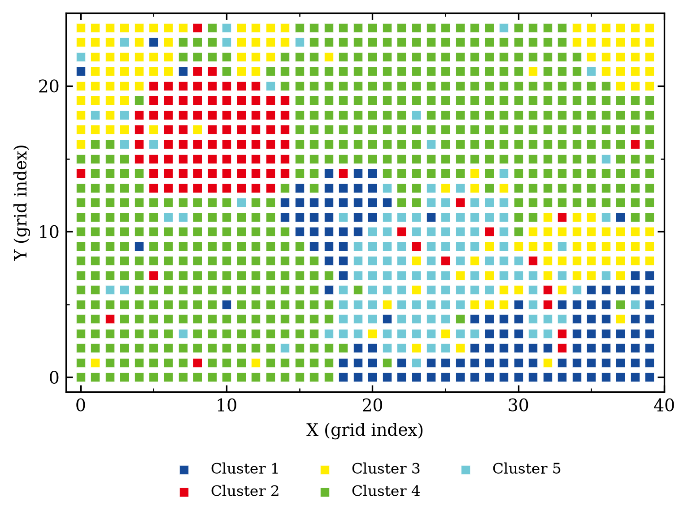
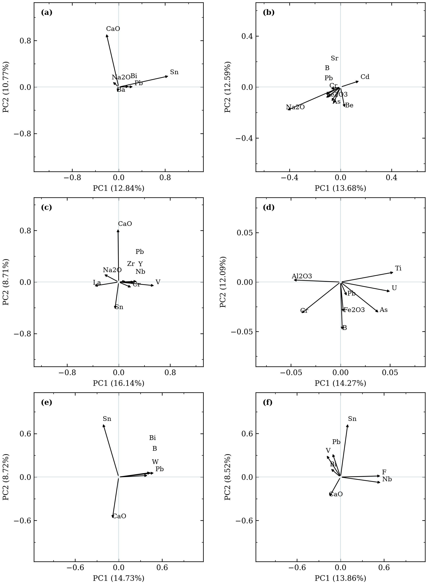
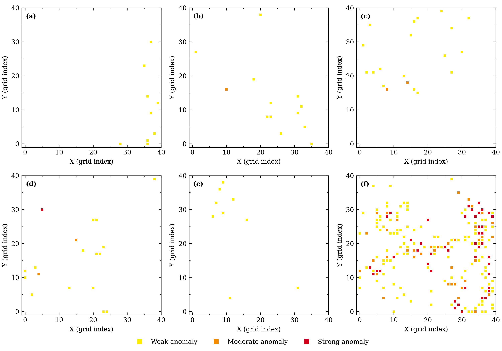

# EM–FMCD geochemical anomaly analysis

This repository contains the Python programs for EM clustering, robust principal component analysis (RPCA), and fast minimum covariance determinant (FMCD) analysis. The scripts use graphical dialogs and produce Excel workbooks. Code comments are in English; dialogs and workbook labels are in Chinese.

## Files

- [src/01_em_aic.py](src/01_em_aic.py) — EM clustering and AIC analysis.
- [src/02_robust_pca.py](src/02_robust_pca.py) — ILR transformation and robust PCA.
- [src/03_fmcd.py](src/03_fmcd.py) — robust Mahalanobis distance and anomaly classification.
- [examples/](examples/) — synthetic data, generation, analysis, and plotting scripts.
- [results_irregular/](results_irregular/) — results for the synthetic example.
- [docs/USER_GUIDE.md](docs/USER_GUIDE.md) — input formats, options, and outputs.
- [docs/TUTORIAL.md](docs/TUTORIAL.md) — synthetic example and processing steps.

## Installation

Clone the repository and create a Python environment:

```text
git clone https://github.com/xingfu100/em_fmcd.git
cd em_fmcd
python -m venv .venv
```

Activate with `.venv\Scripts\activate` on Windows or `source .venv/bin/activate` on macOS/Linux, and install the dependencies:

```text
python -m pip install -r requirements.txt
```

The applications require Tkinter and a graphical desktop. Tests were run on Windows with Python 3.14.5; package versions are recorded in [requirements-tested-windows.txt](requirements-tested-windows.txt).

## Usage

Run each application from the repository root:

```text
python src/01_em_aic.py
python src/02_robust_pca.py
python src/03_fmcd.py
```

The input tables are prepared separately for each step. EM and FMCD use preprocessed variables, whereas RPCA reads strictly positive concentrations and performs CLR and ILR internally. See the [user guide](docs/USER_GUIDE.md) for parameter and workbook details.

## Synthetic example

The example contains 1,000 simulated samples and 39 elements on a 40 × 25 grid. It compares the cluster-specific and whole-region RPCA–FMCD workflows.

```text
python tests/quick_test.py
python examples/synthetic_workflow.py
python examples/plot_results.py
```

The calculations use seed 42 and save results in `results_irregular/`. The [tutorial](docs/TUTORIAL.md) describes the synthetic data, preprocessing, element selection and parameters. The simulation deliberately includes distinct backgrounds and an imposed enrichment pattern; its coordinates and values are not observations from the study area.







[Model summary](results_irregular/model_summary.csv) · [Sample results](results_irregular/sample_comparison.csv) · [RPCA loadings](results_irregular/rpca_loadings.csv) · [Synthetic comparison](results_irregular/detection_comparison.csv)

## Data availability

The study data are not included. The data restriction and access arrangements remain to be supplied by the authors. The synthetic dataset demonstrates the workflow but does not reproduce the manuscript's numerical results; see [DATA_AND_REPRODUCIBILITY.md](docs/DATA_AND_REPRODUCIBILITY.md).

## License

[MIT](LICENSE)
